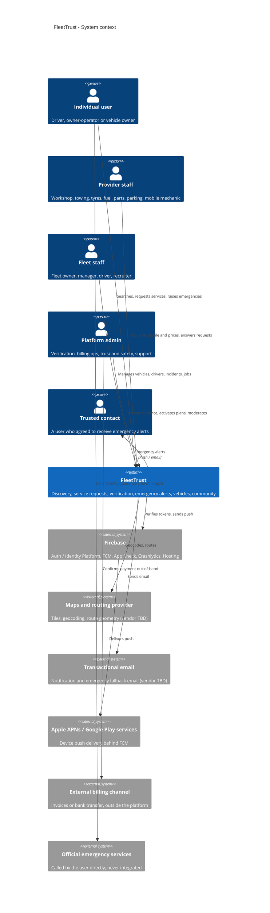
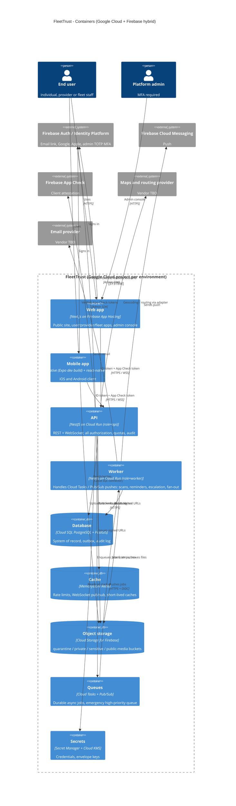
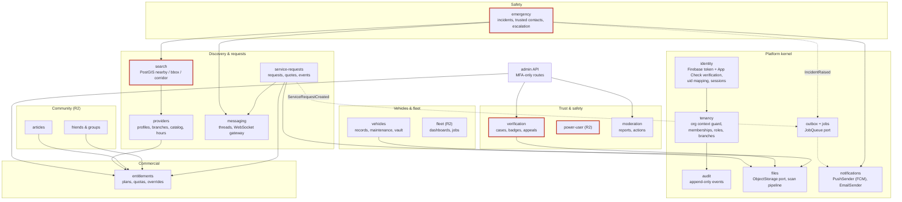
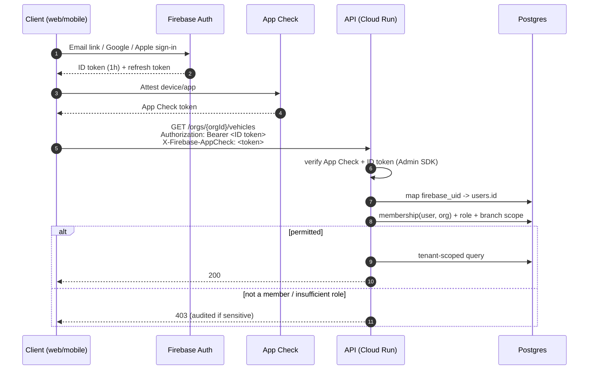
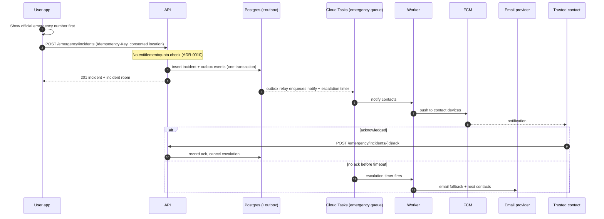

# FleetTrust — C4 model

Diagrams are Mermaid and render on GitHub, GitLab and in VS Code with a Mermaid extension. Decisions behind them are in the [ADRs](../adr/README.md).

## Level 1 — System context

## Level 2 — Containers

## Level 3 — API components (modules)

Shown as a flowchart for readability. Each box is a NestJS module with a public interface. Dashed arrows are domain events; solid arrows are synchronous calls through a module's public interface. Bold red boxes are boundaries enforced by lint rules ([ADR-0009](../adr/0009-trust-independent-of-payment.md), [ADR-0010](../adr/0010-emergency-exempt-from-quotas.md)).

**Boundary rules (enforced in Prompt 02 lint configuration):**

- `verification`, `power-user` and `search` must not import `entitlements` (trust and ranking are independent of payment).
- `emergency` must not import `entitlements` (no quotas on emergencies).
- No module imports another module's repositories; only its `index.ts`.

## Runtime view — sign-in and an authorized API call

## Runtime view — emergency dispatch

